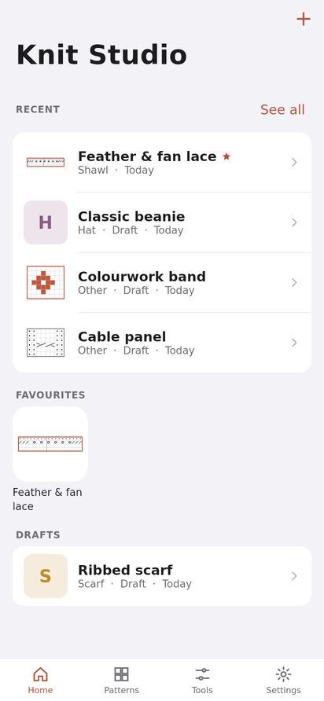
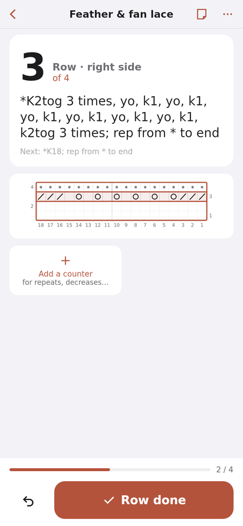

# Knit Studio

A personal knitting pattern studio for Android and iPhone: design a pattern, check that it adds
up, export it as a PDF, and knit from it — offline, with no account.

One Kotlin Multiplatform codebase builds both apps.

| Home | Chart editor | Written rows | Knitting |
|---|---|---|---|
|  |  |  |  |

*(Screenshots are rendered from the shared UI by the automated tests.)*

## What it does

- **Chart editor** built for touch: draw, erase, select, fill, copy/paste, mirror, undo/redo,
  pinch to zoom, repeat boxes, colourwork, cables that behave as one stitch, flat or in the round,
  right- or wrong-side first row, either reading direction.
- **Written rows** that are parsed as you type — `K2, *p2, k2; rep from * to end`,
  `(k2tog, yo) 3 times`, `knit to last 3 sts`, sized counts like `k10 (12, 14)` — with the stitch
  count shown beside every row.
- **Chart ⇄ rows**: write the rows from a chart, or draw the chart from rows. Anything that cannot
  be converted faithfully is reported, never guessed.
- **Check**: a validation engine that finds stitch-count mismatches, repeats that do not fit,
  broken cables, size lists of the wrong length and rows that disagree with their chart — and
  takes you to the exact row or cell.
- **Knitting mode**: one big button per row, the chart row highlighted, repeat tracking, extra
  counters, notes, and your place remembered.
- **Tools**: gauge from a swatch and comparison with the pattern, cast-on for a stitch multiple,
  yarn estimates, needle size table, a stitch library you can extend, a yarn and needle stash.
- **PDF export** with vector charts, stitch key, abbreviations and materials, on A4 or US Letter.
- **`.knit` files and full backups** that move between Android and iOS without loss.

## Status

| | |
|---|---|
| Android | Debug and release APKs build and are installable. App start-up and database verified under Robolectric. |
| iOS | All Kotlin code (including UIKit/PhotosUI interop) compiles for `iosArm64` and `iosSimulatorArm64`. The Xcode project has **not yet been built**, because that needs a Mac — see [docs/INSTALL_IOS.md](docs/INSTALL_IOS.md). |
| Tests | 155 automated tests: knitting engine, persistence and migration, file format, PDF, UI workflows, Android runtime. |

Details, known issues and the roadmap live in [docs/PROJECT.md](docs/PROJECT.md).

## Build

Requirements: JDK 17 or newer (21 recommended). Android SDK with platform 37 for the Android app;
macOS with Xcode 16+ for the iOS app. Gradle is provided by the wrapper.

```bash
git clone https://github.com/BartSchram93/knit-studio.git
```

```bash
cd knit-studio
```

Run all tests:

```bash
./gradlew :shared:jvmTest :composeApp:jvmTest :androidApp:testDebugUnitTest
```

Build the Android APKs (output in `androidApp/build/outputs/apk/`):

```bash
./gradlew :androidApp:assembleDebug :androidApp:assembleRelease
```

- Android installation: [docs/INSTALL_ANDROID.md](docs/INSTALL_ANDROID.md)
- iOS build, signing and installation: [docs/INSTALL_IOS.md](docs/INSTALL_IOS.md)

## Repository layout

```
shared/        Knitting engine, data model, database, file format, PDF writer (no UI code)
composeApp/    Shared Compose Multiplatform interface + platform bridges
androidApp/    Android application shell (manifest, activity, icon)
iosApp/        Xcode project and Swift entry point
docs/          Research, product requirements, architecture, install guides, project log
design/        Design system notes
.github/       CI: tests, APKs, iOS simulator build and unsigned IPA
```

## Documentation

- [Research](docs/RESEARCH.md) · [Product requirements](docs/PRODUCT.md) · [Architecture](docs/ARCHITECTURE.md)
- [File format](docs/FILE_FORMAT.md) · [Design system](design/DESIGN.md)
- [Project log, test results, known issues](docs/PROJECT.md) · [Changelog](CHANGELOG.md) · [Contributing](CONTRIBUTING.md)

Knit Studio is a private, personal project. It contains no network code, analytics or secrets.
